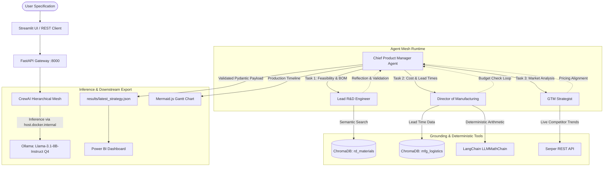

# Autonomous Hierarchical Multi-Agent Product Development Panel

An enterprise-grade, containerized multi-agent system that automates early-stage physical product conceptualization, Bill of Materials (BOM) feasibility, cost optimization, and go-to-market planning. Designed to run on resource-constrained hardware ($\le$ 16GB RAM) via local quantized LLM inference, decoupled tool-calling, and hierarchical reflection loops.

---

## 1. System Overview & Architecture

The architecture enforces a strict supervisor-worker topology using CrewAI. The **Manager Agent** oversees three specialized worker personas to prevent hallucinations, coordinate tool execution, and enforce hard budgetary constraints.



### Agent Personas & Boundary Enforcement

| Agent Persona | Role & Objectives | Bound Tools | Output Artifact |
| --- | --- | --- | --- |
| **Chief Product Manager** | Supervisory orchestrator; task graph decomposition; budget constraint validation. | None (Pure reasoning & delegation) | Synthesized `ProductStrategyPayload` (JSON) |
| **Lead R&D Engineer** | Hardware component selection; structural feasibility; parts catalog verification. | `ComponentRAGTool` (Octopart CPL) | Draft Bill of Materials (BOM) |
| **Director of Manufacturing** | Unit economics; factory overhead; logistics lead times; assembly timeline mapping. | `LogisticsRAGTool`, `ExactMathTool` | Cost Matrix & Mermaid.js Gantt syntax |
| **Go-To-Market Strategist** | Competitor price bands; target demographic definition; retail markup strategy. | `MarketSearchTool` (Serper API) | Market Positioning & Target Pricing |

---

## 2. Repository Structure

```text
product_agent_panel/
├── .env.example                # Template for environment variables
├── .gitignore                  # Git exclusions for venv, secrets, and vector DBs
├── Dockerfile                  # Unified multi-stage container build
├── docker-compose.yml          # Multi-container orchestration & network bridging
├── requirements.txt            # Pinned dependency definitions
├── README.md                   # Project documentation
├── chroma_db/                  # Persistent local ChromaDB vector store
├── data/                       # Raw logistics and BOM datasets
├── results/                    # Exported JSON payloads and Gantt definitions
├── src/
│   ├── __init__.py
│   ├── agents.py               # Persona engineering and Ollama LLM bindings
│   ├── api.py                  # FastAPI REST endpoints
│   ├── app.py                  # Streamlit frontend with Mermaid renderer
│   ├── data_pipeline.py        # Ingestion, cleaning, chunking, and embedding
│   ├── main.py                 # Task definitions, Crew orchestration, Pydantic schemas
│   └── tools.py                # Subclassed CrewAI deterministic and RAG tools
└── tests/
    ├── __init__.py
    └── test_tools.py           # Pytest suite for tool calling and schema validation

```

---

## 3. Technology Stack

* **Orchestration:** CrewAI, LangChain Core
* **Inference Engine:** Ollama serving `Llama-3.1-8B-Instruct` (4-bit quantization, Q4_K_M)
* **Embeddings & Vector Store:** `sentence-transformers/all-MiniLM-L6-v2`, ChromaDB
* **Validation & Types:** Pydantic v2
* **Web Services & Interface:** FastAPI, Uvicorn, Streamlit, `streamlit-mermaid`
* **External APIs:** Serper.dev REST API
* **Infrastructure:** Docker, Docker Compose

---

## 4. Getting Started

### Prerequisites

* 16 GB RAM minimum with at least 4 CPU cores
* Docker Desktop & Docker Compose installed
* Ollama installed natively on the host machine
* Python 3.10+ (if running locally without Docker)

### Step 1: Host LLM Configuration

Pull and run the base quantized model locally:

```bash
ollama run llama3:8b

```

Ensure Ollama is accessible at `http://localhost:11434`.

### Step 2: Environment Setup

Clone the repository and create the `.env` file:

```bash
git clone https://github.com/your-org/product_agent_panel.git
cd product_agent_panel
cp .env.example .env

```

Edit `.env` and add your Serper API key:

```env
SERPER_API_KEY=your_serper_api_key_here

```

### Step 3: Populate the Vector Store

Before starting the application, run the ingestion pipeline to build the local ChromaDB collections:

```bash
pip install -r requirements.txt
python src/data_pipeline.py

```

### Step 4: Run via Docker Compose

Build and launch the containerized FastAPI backend and Streamlit frontend:

```bash
docker-compose up --build -d

```

* **FastAPI Documentation:** Open `http://localhost:8000/docs`
* **Streamlit Interface:** Open `http://localhost:8501`

---

## 5. API Reference

### Trigger Planning Session

`POST /api/v1/plan/generate`

#### Request Payload

```json
{
  "product_spec": "Portable solar-powered outdoor air quality monitor",
  "budget_usd": 65.00
}

```

#### Response Payload (`ProductStrategyPayload`)

```json
{
  "product_name": "Solar Outdoor Air Quality Monitor",
  "target_market": "Environmental Monitoring / Smart Agriculture",
  "technical_feasibility": {
    "bill_of_materials": [
      {
        "component_id": "cpl_12_C0603C180J5GACTU",
        "description": "Ceramic Capacitor 18pF 50V",
        "quantity": 4,
        "unit_cost": 0.15,
        "total_cost": 0.60
      }
    ],
    "total_raw_material_cost": 24.80
  },
  "manufacturing_plan": {
    "assembly_overhead_cost": 8.50,
    "total_unit_cost": 33.30,
    "projected_lead_time_weeks": 6,
    "gantt_chart_mermaid": "gantt\n  dateFormat YYYY-MM-DD\n  title Production Schedule\n  section Sourcing\n  BOM Procurement :2026-10-01, 14d"
  },
  "market_strategy": {
    "competitor_price_range": {
      "min": 79.99,
      "max": 129.99
    },
    "recommended_retail_price": 89.99,
    "projected_profit_margin_percent": 63.0,
    "target_demographic": "Municipalities and IoT Agritech Operators"
  },
  "validation_status": "APPROVED"
}

```

---

## 6. Downstream Business Intelligence Integration

The system writes the final strategy directly to `results/latest_strategy.json`.

1. **Power BI Ingestion:** Open Power BI Desktop $\rightarrow$ **Get Data** $\rightarrow$ **JSON** $\rightarrow$ Select `results/latest_strategy.json`.
2. **Schema Unrolling:** Use the Power Query ribbon to convert the payload to a table, expand `technical_feasibility` and `manufacturing_plan`, and expand `bill_of_materials` to new rows.
3. **Financial DAX Calculations:**

$$\text{Gross Margin} = \frac{\text{Recommended Retail Price} - \text{Total Unit Cost}}{\text{Recommended Retail Price}} \times 100$$


---

## 7. Testing & Quality Assurance

Run the automated test suite to verify tool accuracy, schema constraints, and error-handling routines:

```bash
pytest tests/ -v

```

### Key Test Coverage

* **`test_exact_math_tool_accuracy`:** Validates that complex BOM arithmetic returns exact floating-point values via Python REPL rather than LLM token approximations.
* **`test_math_tool_error_handling`:** Confirms conversational queries passed to numerical tools trigger structured error strings for ReAct self-correction.
* **`test_pydantic_schema_validation`:** Verifies that exported payloads strictly conform to typing constraints expected by downstream BI pipelines.